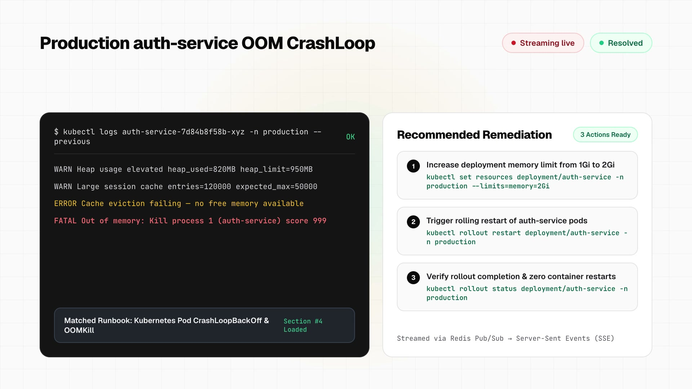
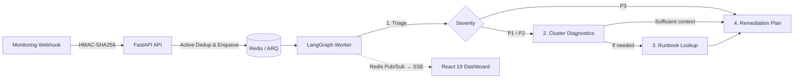

# Autage

<p align="center">
  
</p>

<p align="center">
  <strong>Autonomous Agentic SRE Copilot for Kubernetes Incident Triage & Remediation</strong>
</p>

<p align="center">
  
</p>

Autage is a self-hosted SRE agent that receives monitoring alerts over webhooks, executes read-only Kubernetes diagnostics (`kubectl`), cross-references operational runbooks, and streams step-by-step triage and remediation plans to a real-time web dashboard.

> **Demo Video:** [Watch the launch overview (`docs/assets/demo.mp4`)](docs/assets/demo.mp4)

---

## Architecture



### Pipeline Stages

1. **Triage (`process_alert`)** — Parses raw JSON alert payloads from any monitoring tool (Datadog, Prometheus Alertmanager, Grafana, Sentry, PagerDuty) without per-source schema adapters, classifies severity (`P1`–`P3`), and summarizes impact.
2. **Cluster Diagnostics (`fetch_logs`)** — For `P1`/`P2` incidents, plans and executes read-only `kubectl` commands (`logs`, `logs --previous`, `describe pod`, `get events`, `get deployment`) asynchronously in a worker threadpool against the connected Kubernetes cluster and summarizes findings.
3. **Runbook Lookup (`refer_runbooks`)** — Two-pass structural retrieval over chunked Markdown runbooks stored in PostgreSQL: first inspects runbook titles and section headings, then fetches only the relevant sections to keep token usage bounded.
4. **Remediation Synthesis (`recommended_steps`)** — Combines alert context, cluster logs, and matched runbook procedures into ordered remediation steps.

Each of the four stages can be routed to a different LLM provider and model (`Google Gemini`, `OpenAI`, `Anthropic`, `OpenRouter`, or local `Ollama`) from the **Settings** page.

---

## Key Features

- **Encrypted Credential Store**: LLM API keys, webhook signing secrets, and Kubernetes ServiceAccount tokens are encrypted at rest in PostgreSQL using Fernet (`AUTAGE_SECRET_KEY`).
- **Kubernetes Integration**: Connect a real cluster via its API Server URL and a read-only `view` ServiceAccount bearer token, or run locally in simulated cluster mode (`MOCK_KUBECTL=True`).
- **Real-Time SSE Streaming**: Every node transition and `kubectl` command output is published over Redis Pub/Sub and streamed to the browser via Server-Sent Events with race-condition-safe status reconciliation.
- **Active-Incident Deduplication**: Computes SHA-256 payload fingerprints and deduplicates against currently active (`PENDING`/`TRIAGING`) incidents while allowing recurring alerts after resolution.
- **Client-Side Runbook Chunker**: Parses Markdown runbooks (and YAML frontmatter) into discrete, ordered sections with token estimates before indexing.
- **Single-User Auth**: Initial setup flow creates the administrator account (`bcrypt` password hashing + `HttpOnly` JWT session cookies) and protects all dashboard and API routes.

---

## Quickstart (Full Stack with Docker Compose)

Start PostgreSQL, Redis, FastAPI, the ARQ worker, and the React dashboard in a single command:

```bash
cp .env.example .env
# Generate a Fernet master key and set AUTAGE_SECRET_KEY in .env:
python3 -c "from cryptography.fernet import Fernet; print(Fernet.generate_key().decode())"

docker compose up --build
```

Then open `http://localhost:5173`.

---

## Local Development Setup

**Requirements:** Python 3.13+, [uv](https://docs.astral.sh/uv/), Docker, Node.js 22+.

```bash
# 1. Install Python dependencies (including dev/test dependencies)
uv sync

# 2. Start PostgreSQL and Redis only
docker compose up -d db redis

# 3. Configure environment
cp .env.example .env
cp services/dashboard/.env.example services/dashboard/.env
# Generate a Fernet key and set AUTAGE_SECRET_KEY in .env:
uv run python -c "from cryptography.fernet import Fernet; print(Fernet.generate_key().decode())"

# 4. Run database migrations
uv run alembic upgrade head
```

Start the three processes in separate terminals:

```bash
# Terminal 1 — FastAPI server (port 8000)
uv run uvicorn services.http.app:app --reload

# Terminal 2 — ARQ background worker
uv run arq services.worker.main.WorkerSettings

# Terminal 3 — React dashboard (port 5173)
cd services/dashboard && npm install && npm run dev
```

Open `http://localhost:5173`:
1. Complete the one-time account registration screen.
2. Walk through the 5-step **Onboarding** flow:
   - **Step 1 — Alert Webhook & Secret**: Copy the dynamic webhook URL (`${VITE_API_URL}/webhooks/alert`) and generate your HMAC signing secret.
   - **Step 2 — AI Model Providers**: Add at least one provider API key (`Google Gemini`, `OpenAI`, `Anthropic`, `OpenRouter`, or `Ollama`).
   - **Step 3 — Pipeline Model Routing**: Assign models to each of the 4 pipeline stages.
   - **Step 4 — Upload Runbooks**: Upload `.md` operational runbooks to be chunked and indexed.
   - **Step 5 — Kubernetes Cluster**: Connect your cluster via API Server URL + read-only ServiceAccount token (or continue in Mock Cluster Mode).
3. Trigger a test incident directly from the **Dashboard** (or run `uv run python scripts/send_mock_alert.py`).

---

## Running Tests & Linting

```bash
# Backend unit, API route, and LangGraph pipeline tests
uv run pytest -v

# Frontend lint & production typecheck/build
cd services/dashboard && npm run lint && npm run build
```

---

## Repository Layout

```text
services/
├── agent/          # LangGraph state, nodes, prompts, kubectl & runbook tools, LLM registry
├── db/             # Async SQLAlchemy 2.0 models (Incident, Runbook, Credential, User)
├── http/           # FastAPI application, JWT cookie auth, REST & SSE endpoints
├── secrets/        # Fernet encryption wrapper and SecretStore DAO
├── worker/         # ARQ worker executing the LangGraph pipeline and publishing Redis events
└── dashboard/      # React 19 + TypeScript + Tailwind v4 SPA
tests/
├── agent/          # Unit & integration tests for graph, llm/, nodes/, prompts/, and tools/
├── db/             # Database session and SQLAlchemy model tests (models/)
├── http/           # FastAPI app, JWT auth, HMAC webhook, routes/, and schemas/ tests
├── secrets/        # Fernet crypto and SecretStore DAO tests
└── worker/         # ARQ worker lifecycle and Redis Pub/Sub event tests
```

## License

Apache License 2.0 — see [LICENSE](LICENSE).
