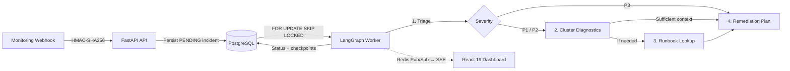

# Autage

<p align="center">
  
</p>

<p align="center">
  <strong>Autonomous Agentic SRE Copilot for Kubernetes Incident Triage & Remediation</strong>
</p>

<p align="center">
  
</p>


Autage is a self-hosted SRE agent that receives monitoring alerts over webhooks, executes read-only Kubernetes diagnostics (`kubectl`), cross-references operational runbooks, and streams step-by-step triage and remediation plans to a real-time web dashboard.

---

## Architecture



### Pipeline Stages

1. **Triage (`process_alert`)** — Parses raw JSON alert payloads from any monitoring tool (Datadog, Prometheus Alertmanager, Grafana, Sentry, PagerDuty) without per-source schema adapters, classifies severity (`P1`–`P3`), and summarizes impact.
2. **Cluster Diagnostics (`fetch_logs`)** — For `P1`/`P2` incidents, plans and executes read-only `kubectl` commands (`logs`, `logs --previous`, `describe pod`, `get events`, `get deployment`) asynchronously in a worker threadpool against the connected Kubernetes cluster and summarizes findings.
3. **Runbook Lookup (`refer_runbooks`)** — Two-pass structural retrieval over chunked Markdown runbooks stored in PostgreSQL: first inspects runbook titles and section headings, then fetches only the relevant sections to keep token usage bounded.
4. **Remediation Synthesis (`recommended_steps`)** — Combines alert context, cluster logs, and matched runbook procedures into ordered remediation steps.

Each of the four stages can be routed to a different LLM provider and model (`Google Gemini`, `OpenAI`, `Anthropic`, `OpenRouter`, or local `Ollama`) from the **Settings** page.

---

## Key Features

- **Encrypted Credential Store**: LLM API keys, webhook signing secrets, and Kubernetes ServiceAccount tokens are encrypted at rest in PostgreSQL using Fernet (`AUTAGE_SECRET_KEY`).
- **Kubernetes Integration**: Connect a real cluster via its API Server URL and a read-only `view` ServiceAccount bearer token (see `docs/testing-with-kind.md` for a free local kind setup and `scripts/verify_k8s_readonly.sh` for the permission audit).
- **Real-Time SSE Streaming**: Every node transition and `kubectl` command output is published over Redis Pub/Sub and streamed to the browser via Server-Sent Events with race-condition-safe status reconciliation.
- **Active-Incident Deduplication**: Computes SHA-256 payload fingerprints and deduplicates against currently active (`PENDING`/`TRIAGING`) incidents while allowing recurring alerts after resolution.
- **Client-Side Runbook Chunker**: Parses Markdown runbooks (and YAML frontmatter) into discrete, ordered sections with token estimates before indexing.
- **Single-User Auth**: Initial setup flow creates the administrator account (`bcrypt` password hashing + `HttpOnly` JWT session cookies) and protects all dashboard and API routes.

---

## Design Decisions

**Read-only cluster access is enforced by function tools, not by prompts.**
The agent never assembles shell commands — it calls fixed Python functions such as
`get_pod_logs()`, `describe_pod()`, `get_events()`, and `get_deployment()`, where the
LLM only supplies parameters (namespace, pod name, tail count). Since no mutating
executor exists, *no prompt injection or hallucination can reconfigure, delete, or
scale anything in the cluster*. Read-only is also enforced one layer deeper: the
connected identity is a Kubernetes ServiceAccount bound to the `view` role
(`get`/`list`/`watch` verbs only — Secret resources are excluded), so even a
hallucinated `delete` command is rejected by the API server itself, before the
agent's own tool surface could matter. When the host has no `kubectl` binary, the
same read-only verbs fall back to direct HTTPS calls against the Kubernetes API Server.

**Alert payloads are stored raw and parsed by the LLM — no per-provider adapters.**
Datadog, Prometheus/Alertmanager, Grafana, Sentry, and PagerDuty each have a
different payload shape. Rather than maintaining one schema adapter per tool (which
grows linearly and rots), the webhook validates the HMAC signature and stores the
JSON as-is; the triage stage — routed to whichever model is strongest at extraction
— normalizes it. Adding "support" for a new monitoring tool is therefore
a zero-code setting.

**Runbook lookup is two-pass and token-bounded.**
Pass 1 fetches only runbook titles plus section headings; the LLM declares *which
specific sections* to open. Pass 2 loads just those section chunks. This keeps the
context window proportional to relevance rather than to total documentation size,
which matters when runbooks are 30+ pages of Markdown.

**Deduplication is idempotent against *active* incidents only.**
Ingest computes a SHA-256 fingerprint over the canonically-sorted raw payload and
drops duplicates only while an incident with the same fingerprint is still
`PENDING`/`TRIAGING`. Flaky alerting storms — the classic 30-acks-per-minute pager
event — produce one agent run, while a legitimately recurring alert *after
resolution* still creates a fresh incident.

**Model routing is per pipeline stage, not per app.**
A P3 alert that only needs triage may run on a local Ollama model, while the
remediation synthesis for a P1 runs on the strongest frontier model. The routing
table lives in the Settings UI (one provider per stage), so each deployment can
trade cost, latency, and privacy to its own preference.

---

## Scope: What's Proven vs. What Production Would Require

Autage is proven end-to-end against a **real Kubernetes cluster** (kind): real
webhook ingestion, LLM-planned read-only `kubectl` executed against live pods,
runbook retrieval, and streamed remediation — the entire pipeline, no mocks.

**Trust boundaries implemented today:**

- Read-only enforcement is two-layered: the agent's tool surface exposes only
  read verbs, and the cluster identity is a ServiceAccount bound to the `view`
  role (`get`/`list`/`watch` only, no Secret access) — the API server itself
  rejects anything destructive, so even a hallucinated command cannot mutate
  the cluster.
- All credentials (LLM keys, webhook signing secret, SA token, cluster CA
  certificate) are Fernet-encrypted at rest in PostgreSQL; tokens are masked in
  command diagnostics.
- Cluster connections are **TLS-verified against the cluster's own CA
  certificate — mandatory, with no skip-verify path**. The CA is stored
  encrypted alongside the token and handed to both the kubectl path
  (`--certificate-authority`) and the direct-HTTPS fallback; connections
  without a CA are rejected. The kind setup script prints it ready to paste.
- Every monitoring payload is HMAC-verified before ingestion; the dashboard is
  single-user with bcrypt + `HttpOnly` JWT session cookies.

**Deliberately out of scope** (a conscious single-tenant, dev-grade trade-off —
not unknown, and each item below has a known design path):

| Gap | Why deferred | Production design |
|---|---|---|
| Token auto-rotation / OIDC identity | The stored long-lived token matches the current single-tenant credential-row model | Short-lived TokenRequest tokens fetched per run, or org OIDC; theft-window shrinks to minutes |
| Namespace-scoped permissions | `view` is cluster-wide read, fine for a test cluster | `Role` + `RoleBinding` in one namespace instead of `ClusterRoleBinding` |
| Output truncation for large namespaces | Test cluster has one broken pod | Per-tool output caps before results enter the LLM context |
| Multi-tenant credentials | One user / one cluster by design | Tenant-keyed credential rows + `tenant_id` on incidents |
| Dashboard TLS / secret-manager for `AUTAGE_SECRET_KEY` | Dev-grade compose deployment | Standard reverse-proxy + vault setup, orthogonal to the agent |

---

## Quickstart (Full Stack with Docker Compose)

**Requirements:** Docker (for testing, optionally `kind` + `kubectl` — the setup script installs them via Homebrew).

Start PostgreSQL, Redis, FastAPI, the Postgres-backed worker, the React dashboard,
and Caddy for HTTPS in a single command:

```bash
cp .env.example .env
# Required: generate a Fernet credential-encryption key for AUTAGE_SECRET_KEY.
python3 -c "from cryptography.fernet import Fernet; print(Fernet.generate_key().decode())"
# Required: generate a separate JWT signing key for JWT_SECRET_KEY.
python3 -c "import secrets; print(secrets.token_urlsafe(48))"
# Required: generate a strong database password for DB_PASSWORD.
python3 -c "import secrets; print(secrets.token_urlsafe(32))"
# Required for first-user setup and password recovery: generate AUTAGE_SETUP_TOKEN.
# Keep it secret; the same token resets the admin password if forgotten.
python3 -c "import secrets; print(secrets.token_urlsafe(48))"
# The app and Compose refuse to start unless required values are set.

docker compose up --build

# Optional, but makes the demo real end-to-end: one command creates a disposable
# genuine Kubernetes cluster (kind) with a crashing app + a read-only bot account:
bash scripts/setup_kind_cluster.sh
```

Then open `https://localhost` (Caddy uses a local CA; see
[`docs/https-deployment.md`](docs/https-deployment.md) if the browser warns):

1. Complete the one-time account registration screen using the `AUTAGE_SETUP_TOKEN` value from `.env`. Keep the token: it is also used from **Forgot password?** on the login screen to reset the administrator password.
2. Walk through the 5-step **Onboarding** flow:
   - **Step 1 — Alert Webhook & Secret**: Copy the dynamic webhook URL (`https://<AUTAGE_HOST>/api/webhooks/alert`) and generate your HMAC signing secret.
   - **Step 2 — AI Model Providers**: Add at least one provider API key (`Google Gemini`, `OpenAI`, `Anthropic`, `OpenRouter`, or `Ollama`). Model lists are fetched live from each provider once a key is saved.
   - **Step 3 — Pipeline Model Routing**: Assign models to each of the 4 pipeline stages.
   - **Step 4 — Upload Runbooks**: Upload `.md` operational runbooks to be chunked and indexed.
   - **Step 5 — Kubernetes Cluster**: Connect a cluster via API Server URL + read-only ServiceAccount token (the kind script above already created one — it printed both values ready to paste).
3. Trigger a test incident directly from the **Dashboard**.

Host-run scripts that read the database need the optional dev override:

```bash
docker compose -f docker-compose.yml -f docker-compose.dev.yml up -d db redis
uv run python scripts/send_mock_alert.py
```

The default stack keeps Postgres and Redis off the host network.

### Backups

Create a compressed PostgreSQL backup with:

```bash
bash scripts/backup_postgres.sh
```

Restore and verification steps are in [`docs/backup-restore.md`](docs/backup-restore.md).

---

## Running Tests & Linting

```bash
# Backend unit, API route, and LangGraph pipeline tests
uv run pytest -v

# Frontend lint & production typecheck/build
cd services/dashboard && npm run lint && npm run build
```

---

## Repository Layout

```text
services/
├── agent/          # LangGraph state, nodes, prompts, kubectl & runbook tools, LLM registry
├── db/             # Async SQLAlchemy 2.0 models (Incident, Runbook, Credential, User)
├── http/           # FastAPI application, JWT cookie auth, REST & SSE endpoints
├── secrets/        # Fernet encryption wrapper and SecretStore DAO
├── worker/         # Postgres queue worker with LangGraph checkpoint resume and Redis events
└── dashboard/      # React 19 + TypeScript + Tailwind v4 SPA
tests/
├── agent/          # Unit & integration tests for graph, llm/, nodes/, prompts/, and tools/
├── db/             # Database session and SQLAlchemy model tests (models/)
├── http/           # FastAPI app, JWT auth, HMAC webhook, routes/, and schemas/ tests
├── secrets/        # Fernet crypto and SecretStore DAO tests
└── worker/         # Queue claiming, checkpoint resume, retry, and Pub/Sub tests
```

## License

Apache License 2.0 — see [LICENSE](LICENSE).
