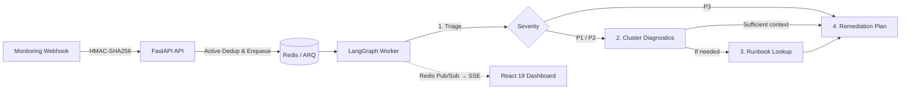

# Autage

Autage is a self-hosted SRE agent that receives monitoring alerts over webhooks, executes read-only Kubernetes diagnostics (`kubectl`), cross-references operational runbooks, and streams step-by-step triage and remediation plans to a real-time web dashboard.

## Architecture

### Pipeline Stages

1. **Triage (`process_alert`)** — Parses raw JSON alert payloads from any monitoring tool (Datadog, Prometheus Alertmanager, Grafana, Sentry, PagerDuty) without per-source schema adapters, classifies severity (`P1`–`P3`), and summarizes impact.
2. **Cluster Diagnostics (`fetch_logs`)** — For `P1`/`P2` incidents, plans and executes read-only `kubectl` commands (`logs`, `logs --previous`, `describe pod`, `get events`, `get deployment`) asynchronously in a worker threadpool against the connected Kubernetes cluster and summarizes findings.
3. **Runbook Lookup (`refer_runbooks`)** — Two-pass structural retrieval over chunked Markdown runbooks stored in PostgreSQL: first inspects runbook titles and section headings, then fetches only the relevant sections to keep token usage bounded.
4. **Remediation Synthesis (`recommended_steps`)** — Combines alert context, cluster logs, and matched runbook procedures into ordered remediation steps.

Each of the four stages can be routed to a different LLM provider and model (`Google Gemini`, `OpenAI`, `Anthropic`, `OpenRouter`, or local `Ollama`) from the **Settings** page.

---

