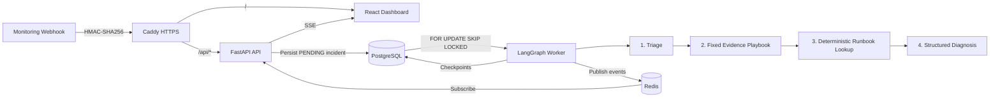

# Autage

<p align="center">
  
</p>

<p align="center">
  <strong>Read-only Kubernetes incident copilot for CrashLoopBackOff and bad deployments</strong>
</p>

<p align="center">
  
</p>

Autage is a self-hosted, single-admin SRE copilot. It receives monitoring alerts over signed webhooks, runs a fixed read-only evidence playbook against Kubernetes, matches your operational runbooks, and streams a structured diagnosis to a real-time dashboard.

v1.0 is deliberately read-only: Autage never restarts, rolls back, scales, or deletes anything in your cluster.

---

## Supported Incident Types

| Incident type | Typical alert | Evidence collected |
|---|---|---|
| `crash_loop` | CrashLoopBackOff, repeated container restarts, OOMKilled, exit code 137 | Deployment pods, pod status, previous and current logs, deployment state, namespace events |
| `bad_deployment` | Failed rollout, bad revision, service failure right after a deploy | Deployment state, rollout history, deployment pods, affected pod logs, namespace events |

Any other incident type is accepted, but Autage skips cluster access and returns a conservative diagnosis based only on the alert.

---

## Architecture



PostgreSQL is the source of truth for incidents, the work queue, runbooks, credentials, and LangGraph checkpoints. Redis carries live events to the API for SSE streaming and stores authentication rate-limit counters. Caddy is the only public entrypoint and terminates HTTPS.

### Pipeline Stages

1. **Triage (`triage`)** — Extracts the incident type, severity, summary, and exact Kubernetes target identifiers from the raw alert. It never chooses commands.
2. **Evidence Collection (`collect_evidence`)** — Runs the fixed playbook for the incident type. Tools are read-only, outputs are capped, and missing targets are recorded as gaps instead of guessed.
3. **Runbook Lookup (`find_runbook`)** — Matches runbooks deterministically by service ownership and incident keywords, then loads a bounded set of relevant sections.
4. **Diagnosis (`diagnose`)** — Turns the alert, evidence, and runbook context into one structured result for the operator.

Only `triage` and `diagnose` call an LLM. Each can use a different provider and model from **Settings → Pipeline Model Routing**: Google Gemini, OpenAI, Anthropic, OpenRouter, or a local Ollama instance.

### What a Diagnosis Contains

- **What happened** — a short factual description.
- **Likely cause** — the most probable explanation, or `Unclear` when evidence is insufficient.
- **Confidence** — `low`, `medium`, or `high`, downgraded automatically when evidence is missing.
- **What I found** — the strongest specific observations.
- **Missing information** — failed or unavailable evidence.
- **Recommended steps** — ordered next actions for a human operator.

---

## Key Features

- **Fixed, auditable investigation**: every incident follows the same graph. The model can classify the incident, but it cannot add tools, skip steps, or choose runbook sections.
- **Read-only in depth**: the agent exposes only read functions, has no shell access, and connects with a Kubernetes ServiceAccount bound to the `view` role. TLS verification against the cluster CA is mandatory.
- **Structured diagnosis**: the result is persisted as JSON and rendered as a diagnosis card, not free-form markdown.
- **Deterministic runbook matching**: service ownership plus incident keywords select at most three runbooks and three sections each, with a hard character budget.
- **Real-time SSE streaming**: node transitions and evidence records are published through Redis and streamed to the browser with race-safe status reconciliation.
- **Encrypted credential store**: LLM API keys, the webhook signing secret, and the Kubernetes ServiceAccount token are Fernet-encrypted at rest in PostgreSQL.
- **Signed webhooks with active-incident deduplication**: every payload is HMAC-verified; SHA-256 fingerprints suppress duplicate alerts only while the matching incident is still `PENDING` or `TRIAGING`.
- **Hardened single-admin auth**: setup-token registration and password recovery, Redis-backed login rate limiting, generic login failures, CSRF protection for authenticated writes, bcrypt hashing, and 24-hour JWT session cookies.
- **Durable execution**: PostgreSQL queue with `FOR UPDATE SKIP LOCKED`, bounded retries, stale-lease recovery, and LangGraph checkpoints that resume interrupted runs after a worker restart.
- **Secure default deployment**: Caddy HTTPS, `Secure` cookies, restricted CORS, baseline security headers, and private PostgreSQL/Redis networks.
- **Operational basics**: Postgres and Redis health checks, a one-command database backup script, and a Kubernetes read-only permission audit.

---

## Design Decisions

**The investigation path is fixed; the model does not choose tools.**
The graph is always `triage → collect_evidence → find_runbook → diagnose`. Triage extracts the incident type and target identifiers, and a hard-coded playbook decides which read-only calls run. Unsupported incident types skip the cluster entirely. This makes every run predictable, auditable, cheap, and resistant to prompt injection: a malicious alert cannot talk the agent into running a different command.

**Read-only is enforced in depth.**
The tool surface contains only read functions — no shell executor and no mutating calls exist. The cluster identity is a ServiceAccount bound to the built-in `view` role (`get`/`list`/`watch`, no Secret access), so even a hallucinated destructive request would be rejected by the Kubernetes API server. TLS verification against the cluster's own CA is mandatory, tokens are written to a private temporary kubeconfig instead of argv, and output, log tails, and evidence lists are capped.

**Runbook selection is deterministic and token-bounded.**
Runbooks are scored by exact service ownership and incident keywords, then only a few relevant sections are loaded (at most three runbooks, three sections each, 14k characters total). The model never chooses which runbook or section to read, so results are reproducible and the context window stays proportional to relevance rather than total documentation size.

**Alert payloads are stored raw and parsed by the LLM — no per-provider adapters.**
Datadog, Prometheus/Alertmanager, Grafana, Sentry, and PagerDuty each have a different payload shape. Rather than maintaining one schema adapter per tool, the webhook verifies the signature and stores the JSON as-is; triage normalizes it. Adding support for another monitoring tool is therefore a zero-code setting.

**Deduplication is idempotent against active incidents only.**
Ingestion computes a SHA-256 fingerprint over the canonically sorted raw payload and drops duplicates only while an incident with the same fingerprint is still `PENDING` or `TRIAGING`. Alert storms produce one agent run, while a legitimately recurring alert after resolution still creates a fresh incident.

**PostgreSQL owns work and progress; Redis is only the live channel.**
The worker claims incidents directly from PostgreSQL with `FOR UPDATE SKIP LOCKED`, records each attempt, and resumes from LangGraph checkpoints after a crash. Redis is not part of the delivery guarantee — it only fans out live events and rate-limit counters. Restarting Redis cannot lose an incident.

---

## v1.0 Scope and Trust Boundaries

Autage v1.0 is built for a **self-hosted, single-admin deployment watching one cluster for a small trusted group**. It is intentionally an MVP, not a multi-tenant production SaaS.

**Implemented today:**

- Fixed read-only playbooks; the LLM never selects tools or runbook sections.
- Read-only Kubernetes identity (`view` role) plus a permission audit script.
- Mandatory TLS verification of the Kubernetes API server with no skip-verify path.
- Encrypted credentials at rest and masked previews in the UI.
- HMAC-signed webhooks with a database-configured secret.
- HTTPS through Caddy, secure cookies, restricted CORS, and baseline security headers.
- Required, independent secrets validated at startup; `.env` permission and uniqueness checks.
- Setup-token registration, password reset, login rate limiting, CSRF protection, and 24-hour sessions.
- PostgreSQL queue with bounded retries, timeout, stale-lease recovery, and LangGraph checkpoints.
- Health checks for PostgreSQL and Redis, database backup/restore docs, and a one-command backup script.

**Deliberately deferred until after v1.0:**

| Area | Current v1.0 behavior | Next step |
|---|---|---|
| Kubernetes identity | Long-lived read-only ServiceAccount token stored encrypted | Short-lived TokenRequest tokens or OIDC federation |
| Permission scope | Cluster-wide `view` role | Namespace-scoped `Role` + `RoleBinding` |
| Tenancy | One admin, one cluster | Tenant-keyed credentials and `tenant_id` on incidents |
| Audit and observability | Application logs and health checks | Audit trail, metrics, tracing, error tracking, alerting |
| Redis | Private network, no auth or TLS | Password + TLS |
| Container hardening | Docker Compose defaults | Non-root users, read-only filesystems, resource limits, image scanning |
| Delivery | Manual `docker compose up` | CI gates, pinned image digests, dedicated migration job |
| Secret management | Owner-readable `.env` with `chmod 600` | External secret manager |
| Write actions | None — read-only by design | Human-approved restart/rollback with a full audit trail |

---

## Quickstart (Full Stack with Docker Compose)

**Requirements:** Docker. The optional kind demo also needs `kind` and `kubectl`; the setup script installs them through Homebrew on macOS. Generating secrets below uses `uv`; plain `python3` works too if the project dependencies are installed.

```bash
cp .env.example .env
chmod 600 .env
```

Generate these values and paste them into `.env`:

```bash
# AUTAGE_SECRET_KEY — Fernet key for credential encryption
uv run python -c "from cryptography.fernet import Fernet; print(Fernet.generate_key().decode())"

# JWT_SECRET_KEY — independent session-signing secret
uv run python -c "import secrets; print(secrets.token_urlsafe(48))"

# DB_PASSWORD — strong PostgreSQL password
uv run python -c "import secrets; print(secrets.token_urlsafe(32))"

# AUTAGE_SETUP_TOKEN — first-user setup and password recovery
uv run python -c "import secrets; print(secrets.token_urlsafe(48))"
```

Validate the environment and start the stack:

```bash
bash scripts/check_env.sh
docker compose up --build
```

Then open `https://localhost`. Caddy uses a local CA; see [`docs/https-deployment.md`](docs/https-deployment.md) if the browser warns.

1. Complete the one-time registration screen with the `AUTAGE_SETUP_TOKEN` value from `.env`. Keep the token — **Forgot password?** uses the same value to reset the administrator password.
2. Walk through the 5-step **Onboarding** flow:
   - **Step 1 — Alert Webhook & Secret**: Copy the webhook URL (`https://<AUTAGE_HOST>/api/webhooks/alert`) and generate your HMAC signing secret.
   - **Step 2 — AI Model Providers**: Add at least one provider API key. Model lists are fetched live from each provider once a key is saved.
   - **Step 3 — Pipeline Model Routing**: Assign models to the two model-backed stages: **Triage** and **Diagnosis**.
   - **Step 4 — Upload Runbooks**: Upload Markdown runbooks to be chunked and indexed.
   - **Step 5 — Kubernetes Cluster**: Connect a cluster via API Server URL, cluster CA certificate, and read-only ServiceAccount token.
3. Trigger a test incident from the **Dashboard**.

### Optional: Real Local Cluster

Create a disposable kind cluster with a deliberately crashing app and a read-only ServiceAccount:

```bash
bash scripts/setup_kind_cluster.sh
```

The script prints the API Server URL, CA certificate, and token ready to paste into **Settings → Kubernetes**. Verify the account cannot mutate resources or read Secrets:

```bash
bash scripts/verify_k8s_readonly.sh
```

### Sending Alerts from the Host

Host-run scripts need the development override, which exposes PostgreSQL and Redis on loopback only:

```bash
docker compose -f docker-compose.yml -f docker-compose.dev.yml up -d db redis
uv run python scripts/send_mock_alert.py
```

The default Compose stack keeps PostgreSQL and Redis off the host network.

### Backups

Create a compressed PostgreSQL backup with:

```bash
bash scripts/backup_postgres.sh
```

Restore and verification steps are in [`docs/backup-restore.md`](docs/backup-restore.md). Keep `AUTAGE_SECRET_KEY` stable across restores, otherwise encrypted credentials cannot be decrypted.

---

## Running Tests and Linting

```bash
# Backend unit, API route, and LangGraph pipeline tests
uv run pytest -v

# Dashboard lint, typecheck, and production build
cd services/dashboard && npm run lint && npm run build
```

---

## Documentation

| Document | Contents |
|---|---|
| [`docs/https-deployment.md`](docs/https-deployment.md) | Caddy HTTPS, DNS setup, internal CA, and Kubernetes ingress |
| [`docs/backup-restore.md`](docs/backup-restore.md) | PostgreSQL backup and restore procedure |
| [`docs/testing-with-kind.md`](docs/testing-with-kind.md) | Manual real-cluster testing setup |
| [`docs/production-hardening-checklist.md`](docs/production-hardening-checklist.md) | v1.0 hardening status and deferred work |

---

## Repository Layout

```text
deploy/               # Caddy configurations for public and internal HTTPS
scripts/              # Environment checks, kind setup, RBAC audit, backups, mock alerts
services/
├── agent/            # LangGraph pipeline, fixed playbooks, prompts, kubectl & runbook tools
├── db/               # Async SQLAlchemy 2.0 models (Incident, Runbook, Credential, User)
├── http/             # FastAPI app, JWT cookie auth, CSRF, HMAC webhook, REST & SSE
├── secrets/          # Fernet encryption wrapper and SecretStore DAO
├── worker/           # PostgreSQL queue worker, retries, and checkpoint resume
└── dashboard/        # React 19 + TypeScript + Tailwind v4 SPA
tests/
├── agent/            # Graph, playbooks, LLM, nodes, prompts, and tool tests
├── db/               # Database session and SQLAlchemy model tests
├── http/             # App, auth, CSRF, HMAC webhook, routes, and schema tests
├── secrets/          # Fernet crypto and SecretStore DAO tests
└── worker/           # Queue claiming, retry, checkpoint resume, and Pub/Sub tests
```

## License

Apache License 2.0 — see [LICENSE](LICENSE).
